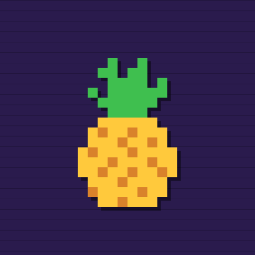

<p align="center">
  
</p>

<h1 align="center">pwnapple</h1>

<p align="center">
  Jailbreak tweaks by Jond-ie, simple to use and tested on real iPhones.<br>
  Rootless (Dopamine) · iOS 15–18
  <br><br>
  <a href="https://jond-ie.github.io/repo/"><strong>See every tweak →</strong></a> · <a href="https://x.com/Jond_ie">X @Jond_ie</a>
</p>

---

## Add the repo

Open [jond-ie.github.io/repo](https://jond-ie.github.io/repo/) on your iPhone and tap **Add to Sileo** or **Add to Zebra**. Or add this source by hand:

```
https://jond-ie.github.io/repo/
```

## Start with these

- **[Triggr](https://jond-ie.github.io/repo/triggr/)**: make any button, gesture or event do anything. Activator, rebuilt for iOS 15–18.
- **[Crest](https://jond-ie.github.io/repo/crest/)**: a music player for your own songs that plays them exactly as good as the files are.
- **[Catapult](https://jond-ie.github.io/repo/catapult/)**: the LineageOS launcher as your iPhone's Home Screen.
- **[FrostBoard](https://jond-ie.github.io/repo/depictions/com.johndie.frostboard.html)**: icon themes on iOS 15–18, using the themes you already have.

There are plenty more: Lock Screen, Face ID, look and feel, privacy, music and fixes. **[Browse them on the site](https://jond-ie.github.io/repo/)**, where you can filter by your iOS version.

## Will it work on my phone?

You need a rootless jailbreak (Dopamine) on iOS 15–18. Each tweak's page says exactly which iOS versions it's tested on. Everything is tested on real iPhones, from the iPhone 7 to the iPhone 11 Pro.

## Bugs and requests

[Open an issue](https://github.com/Jond-ie/repo/issues) with your iPhone model, iOS version and the tweak's version. If a tweak ever puts you in safe mode, uninstall it in your package manager first.

<details>
<summary><strong>Source and credits</strong></summary>

- **Open source:** [Triggr 1.x](https://github.com/Jond-ie/triggr) (GPL-3.0; 2.0 is closed source), [libtriggr](https://github.com/Jond-ie/libtriggr) (MIT, add your tweak to Triggr), [LiteFace](https://github.com/Jond-ie/liteface), [Begonecia](https://github.com/Jond-ie/begonecia).
- **Ports:** Begonecia is a rootless port of [BegoneCIA](https://github.com/larygwil/BegoneCIA) by Eva (Nepeta), MIT; the license ships in the package. Bounce It! is a rootless port of Jake James's Bounce It!. The CCSupport iOS 18 fix is opa334's CCSupport with [our fix](https://github.com/opa334/CCSupport/pull/26).
- **Remakes:** written from scratch, idea credit to the originals. Pinstant (UnlockOrElse by ETHN), FaceSkip (AutoUnlockX by SparkDev), BlankPass (VladGeek), BinaryPass (BinaryPasscode by eskimo), Glide (SlideToUnlock by Nepeta), Shelf (ClassicDock by CoolStar). Triggr is inspired by Activator (Ryan Petrich).
- Everything else is original work by Jond-ie. This repo hosts the installable packages only.

</details>
